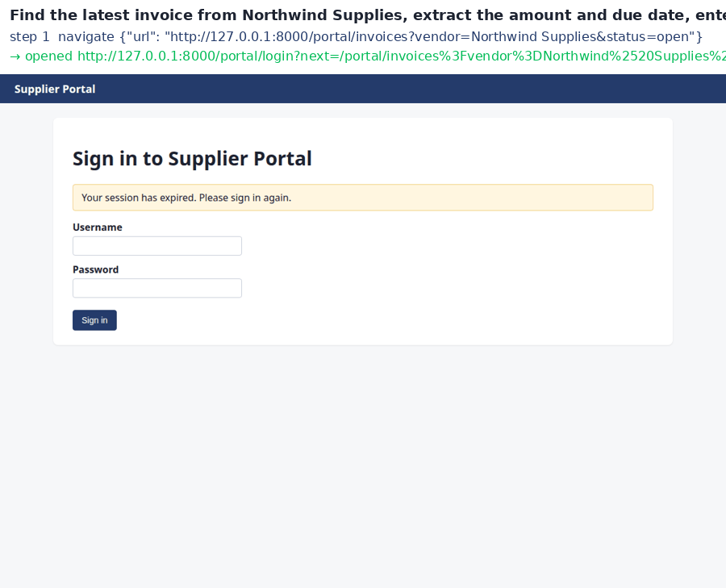

# Autonomous AI Task Worker that learns your company's way of working

Give it a request in plain English: *"Find the latest invoice from Northwind Supplies, extract the amount and due date, enter it into Ledger, and tell me once it is done."* It plans, drives a real browser through the company's systems, reads the document of record, asks a manager before anything risky, refuses to do damage, **proves** the outcome through a channel it cannot fake, and then **remembers** what it learned, as skills, rules and facts with provenance, so the next similar task needs less exploration and fewer questions, even in a system it has never seen.

Submission for the CentrAlign AI **AI Engineering Intern** challenge ("Autonomous AI Task Worker").

> **Demo video:** _link added after recording_ · **GIFs:** [hero task](docs/demo-hero.gif), [under chaos](docs/demo-chaos.gif) · **Step-by-step replays with screenshots:** [docs/example-runs](docs/example-runs/) (open any `replay.html`)



## What makes this one different

Most agent prototypes do the same loop. This one adds three things the brief asks for and most prototypes skip:

1. **It learns from the company.** Verified runs become **skills** (an app-agnostic workflow plus a concrete procedure). Corrections from people become **rules** the policy gate enforces (*"bills over 50,000 need my approval"*) and **facts** about company data (*"the 'Northwind Supplies Ltd' record is stale"*). You can also **show it**: `worker demonstrate` records a person doing the task once and keeps it as a skill. Everything learned is plain JSON with provenance: who said it, when, in which run.
2. **Code decides what is allowed and what is done.** The model proposes; the policy gate checks facts, duplicates, the PDF total and the approval threshold before any click; an independent verifier reads the systems of record through an admin channel the worker cannot use. The model's "done" never sets the status.
3. **It is measured honestly, under chaos.** A harness scores every run against ground truth, counts false claims, and injects real failures: 503s, writes that commit but answer 502, expired sessions, renamed labels. Zero duplicate bills were created across every chaos run.

## Quick start

```bash
make setup            # venv, dependencies, Chromium, seed data
make serve            # the simulated company at http://127.0.0.1:8000
cp .env.example .env  # add GEMINI_API_KEY (free) or a Groq / OpenAI-compatible / Anthropic key

make run TASK="Find the latest invoice from Northwind Supplies, extract the amount and due date, enter it into Ledger, and tell me once it is done"
make run-scripted TASK="Record the latest invoice from Meridian Metals in NovaBooks"   # no model needed
```

Every run writes `runs/<id>/report.md` (facts with provenance, policy decisions, approvals, verifier table), `run.json` and `replay.html` with a screenshot per step.

Teach it:

```bash
python -m worker feedback "From now on bills over 50,000 need my approval before posting." --who priya.manager
python -m worker demonstrate --name "Record a bill in Ledger" --system ledger   # do it once in the browser
python -m worker memory
```

Sign in to the sandbox systems yourself at http://127.0.0.1:8000 with `ops.agent` / `acme-ops-2026`.

## The simulated company

Acme Robotics Pvt Ltd: four real web apps on FastAPI + SQLite, with logins, validation, PDFs and an audit log.

| System | What it is | Traps it contains |
|---|---|---|
| **Supplier Portal** | suppliers publish invoices with PDFs | listed amount typed by the supplier ≠ PDF total; revised invoice `NW-1043-R` supersedes `NW-1043` |
| **Ledger ERP** | record and post supplier bills | vendor master with a stale near-duplicate (`Northwind Supplies Ltd`, different GSTIN); no duplicate enforcement; approval is company policy, not an ERP feature |
| **NovaBooks** | a second ERP the worker never saw | different words (payable, supplier, reference, pay by), three-step wizard, `dd/mm/yyyy` |
| **Acme Mail** | the ops mailbox | the revision notice from Northwind |

`company_context/` is what a new employee gets: `systems.yaml` (where things are and how to sign in), `handbook.md` (the SOP), `policy.yaml` (what the gate enforces). The worker reads these; it does not get a script per task.

## Architecture

```
request ─► Understand ─► Plan ─► ┌─► Observe ─► Decide ─► Act ─┐ ─► Verify ─► Learn ─► Report
           (brain)      (brain)  │   (browser)  (brain)  (runtime)│   (code)    (memory)
                                 └──────── until done ───────────┘
```

| Part | File | Decides |
|---|---|---|
| Brain (LLM or scripted) | `worker/brains/llm_brain.py`, `worker/brains/scripted.py` | meaning of the request, milestones as *target states*, the next tool call |
| Browser + observation | `worker/browser.py` | page → text + numbered elements (ids renumbered every step, so renamed labels do not break it) |
| Runtime + tools | `worker/runtime.py` | executes actions; `commit` cross-checks the form against the declared intent, runs the gate, handles approvals and unknown outcomes |
| Policy gate | `worker/policy.py` | required facts, duplicates, PDF-total match, approval threshold, learned rules |
| Verifier | `worker/verifier.py` | assertions vs the admin snapshot; undeclared writes from the audit log |
| Memory | `worker/memory/store.py` | skills, rules, facts, with provenance |
| Loop + detectors | `worker/loop.py` | wiring, loops/dead ends/expired sessions/5xx hints, learning after verified runs |
| Human channel | `worker/human.py` | CLI, scripted (evals), or none |

Full design: `docs/DESIGN.md`. Why each choice: `docs/DECISIONS.md`. How it is measured: `docs/EVALUATION.md`.

### One run of the hero task, in short

1. **Understand**: *record_supplier_invoice*, vendor Northwind, "latest", target Ledger; no ambiguity, so no question.
2. **Plan**: five target states (invoice identified and PDF read → mailbox checked → vendor resolved by GSTIN and duplicate check done → bill recorded → verified).
3. **Act**: signs in, filters the portal, picks the open revision `NW-1043-R` (not the superseded original), reads the PDF, records `pdf_total`, `due_date`, `po`, `vendor_gstin` with provenance; checks the mailbox; matches the GSTIN on the Vendors page (so the stale `Northwind Supplies Ltd` record is never chosen); searches bills for a duplicate; fills the form; `commit` declares the intent and the gate allows it (or asks the manager if the amount is at or above the threshold); re-reads the list.
4. **Verify**: the verifier confirms a posted bill for GSTIN 07AAACN1234F1Z5 / NW-1043-R with amount 5,980,000 paise, due 2026-11-08, PO-7734, and no undeclared writes.
5. **Learn**: the run becomes a skill. The next Northwind task skips the exploration; after the manager's feedback the gate applies the new threshold automatically.

## Reliability

Chaos is injected by the sandbox itself (`/admin/api/chaos`), seeded so runs repeat:

| Fault | What the worker does |
|---|---|
| `http_503` on a POST | sees the error page, retries the navigation; a submit is never retried blindly |
| `commit_then_502` (the write committed, the response is 502) | records `unknown_outcome`, the gate blocks any resubmit until the list was read back; finds the record; verifies. **Zero duplicates.** |
| `session_expiry_every` N requests | recognises the sign-in page, signs in again, continues the same milestone |
| `ui_drift` (labels renamed) | reads accessible names every step; "Invoice total" is still the amount field |

## Results

Generated by `evals/run_eval.py`; scored by the harness against the admin API, never by the worker. See `docs/EVALUATION.md` for the method and `evals/results/` for every run.

### Runtime guarantees (scripted SOP brain, no model; `make eval-scripted`)

| condition | tasks | success | honest | steps (mean) | LLM calls | tokens | human asks | time (s) |
|---|---|---|---|---|---|---|---|---|
| cold | 12 | 12/12 | 12/12 | 31.2 | 0.0 | 0 | 0.3 | 2 |
| learned | 12 | 12/12 | 12/12 | 31.5 | 0.0 | 0 | 0.5 | 2 |
| unseen | 6 | 6/6 | 6/6 | 41.3 | 0.0 | 0 | 0.7 | 3 |
| chaos | 12 | 12/12 | 12/12 | 35.7 | 0.0 | 0 | 0.3 | 3 |

- 42 measured runs, **42/42 pass, 42/42 honest**, 0 policy blocks needed, 0 false claims.
- **Duplicate records created across all runs, including chaos: 0.** Every task asserts `count == 1` for its invoice, and the chaos condition commits-then-502s on 35% of submits.
- Approvals: every bill at or above the effective threshold was posted only after a manager approval and carries the approver (`T5`, `T9`, and `T1` under the learned 50,000 threshold); the denied case (`T6`) posted nothing and ended `blocked`.
- Unseen app (NovaBooks): 6/6 with frozen code; the wizard, the renamed fields and `dd/mm/yyyy` dates were handled from the handbook plus memory.
- Mean wall time per task: 2.6 s (local sandbox, headless Chromium, a screenshot per step).

### Autonomy and learning (LLM brain; `make eval`)

Measured on free tiers (Groq and Gemini; each row names the models that worked on it, in failover order). The harness scores every run against the admin API, never the worker's own claim:

| condition | tasks | success | honest | steps (mean) | LLM calls | tokens | human asks | time (s) |
|---|---|---|---|---|---|---|---|---|
| cold | 1 | 1/1 | 1/1 | 20.0 | 22.0 | 55701 | 0.0 | 450 |
| learned | 1 | 1/1 | 1/1 | 25.0 | 31.0 | 94663 | 1.0 | 726 |
| unseen | 2 | 1/2 | 2/2 | 25.5 | 44.5 | 131382 | 0.5 | 396 |

- **Cold** (`T1_hero`): **PASS**, verifier `completed`, 20 steps, 22 model calls, 55,701 tokens, 7.5 min, model `qwen/qwen3.8-27b`.
- **Learned** (`T1_hero`): **PASS**, verifier `completed`, 25 steps, 31 model calls, 94,663 tokens, 12.1 min, model `qwen/qwen3.8-27b -> openai/gpt-oss-20b`; 1 manager approval(s); used skill skill_0895f9aa; 3 learned rule(s) in force; 1 policy refusal(s) it then fixed.
- **Unseen app** (`T7_nova_hero`): **PASS**, verifier `completed`, 27 steps, 33 model calls, 96,378 tokens, 3.5 min, model `gemini-3.5-flash -> gemini-3-flash-preview -> gemini-3.5-flash-lite`; 1 manager approval(s); used skill skill_27a460b1; 3 learned rule(s) in force. An earlier attempt (`unseen-T7_nova_hero-attempt1`) is kept in the table as a FAIL: stopped by providers: Groq daily quotas exhausted, then Gemini 503 x3; no write made (fixed in the failover). It was honest: it made no write and claimed nothing.

- **3/4 pass, 4/4 honest**, 413,127 tokens in total (about $0.115 at list price). The time is mostly free-tier rate-limit waiting (8,000 tokens/min).
- What learning changed, visible in the logs: the learned run checked the ops mailbox for the revision notice and confirmed the vendor by GSTIN before writing (the ops lead's and manager's feedback). It also asked a manager to approve the 59,800 bill because of the learned 50,000 limit. The cold run did none of these, and none was required before the feedback.
- Reduced suite: free quotas allow about five runs a day per model, so this covers the three conditions on the hero tasks with one run each, on several free models (the failover list moves on when a quota runs out; each row names its models). The learned memory came from one verified teacher run plus three pieces of feedback (`--teacher-from` replays that recorded run through the learning step). The scripted brain covers the full 42-run matrix above.

What the live runs found (each became a fix and a test; see `git log`):
- A per-day token quota made the provider sleep and retry for 36 minutes with no error. Daily limits now raise `BudgetExhausted`, and `LLM=a,b,c` fails over to the next model mid-run (decision 14).
- The HTTP client logged request URLs, and Gemini's key was a query parameter. Keys now travel in headers, and that logger is off (decision 15).
- A weaker model wrote `pdf_total` without the invoice number, and an empty `duplicate_check` read as "duplicate exists". It looped on refusals for 20 steps. Facts now must name their invoice, empty values are never stored, and the gate treats empty evidence as missing.
- Learning calls inherited the acting prompt, so Qwen wrapped its answers in an action and the run learned nothing. Learning now has its own prompt, an unwrap fallback, and a refusal to store an empty skill.
- Token waste (the PDF read 3–4 times, needless sign-ins, `look` offered to a text-only model) took the hero task from 30 to 20 steps once fixed.
- Transient provider errors (Gemini 503 "high demand") ended the first unseen attempt. The failover now rests a failing model for 3 minutes, tries the next, and waits out a short reset instead of giving up. The re-run hit three 503s and finished anyway.
- After measurement: models often sent `commit` with the intent fields flat (`intent: "record_payable", invoice_number: ...`) and spent 2–4 steps on "bad arguments". `commit` now accepts that shape too. The numbers above predate this fix.

Reproduce: `make eval` with any key in `.env`. Per-run evidence for the three passing runs: `docs/example-runs/llm-*/` (`report.md`, `replay.html`, `worker.log`, `trajectory.jsonl`, screenshots).

## Models, APIs, frameworks

| What | Used for |
|---|---|
| **Playwright (Chromium)** | the browser; observation from the DOM; PDF download with the session |
| **FastAPI, Jinja2, SQLite** | the simulated company and its admin API |
| **pypdf, reportlab** | reading / generating invoice PDFs |
| **Pydantic** | every run artefact is typed data |
| **LLM providers** (plain HTTPS, no SDKs): Gemini (free tier), any OpenAI-compatible endpoint (Groq, OpenRouter, Ollama, OpenAI), Anthropic | the brain; pick with `LLM=provider:model` in `.env` |
| **No agent framework** | the loop is in `worker/loop.py`; every decision point is visible |
| **AI coding assistance** | Claude Code was used while building, reviewing and documenting; every component is tested and I can explain, debug and modify each one |

## Assumptions

- The worker has the same access a human clerk has: the company context (systems, credentials, handbook, policy) and nothing more. It never reads the database.
- The PDF is the document of record; the portal listing and the ERP are not.
- Approvals come from a person through the human channel (CLI prompt, or a script in evaluations); the ERP's "Approved by" field records who approved.
- Amounts are integers in paise everywhere except on screen.
- One task at a time; the sandbox is reset between evaluation runs.

## Known limitations

- Browser and files only: no desktop/OS control (the brief allows restricting scope); vision is optional (`look`) and off by default to keep free models usable.
- The LLM brain's results depend on the model; the scripted brain measures the runtime, not autonomy.
- Learning is verified-run-only and single-company; there is no cross-company transfer or forgetting policy yet.
- The fault model covers the common failures (5xx, expired sessions, renamed labels, commit-then-error), not every real-world one (rate limits, CAPTCHAs, partial page loads).
- The mailbox check is heuristic (search by vendor); a long inbox would need a better reading strategy.
- No resume of an interrupted run yet (every run writes its state, but the loop restarts from the request).

## What I would build next

1. **Resume and pause**: persist the run state so an approval can arrive hours later and the run continues from the same step.
2. **Skill refinement**: merge several verified runs into one skill with confidence; drop steps that never mattered; learn from failures ("don't do X on this site").
3. **Computer use**: a desktop driver with the same observation vocabulary (role + name), so skills recorded in a browser transfer to desktop apps.
4. **Human demonstrations with an LLM in the loop**: turn a recording into a skill with intent, pitfalls and verification, not just steps.
5. **Risk-aware verification**: choose how much to verify by the write's blast radius (amount, reversibility), and auto-rollback where the system allows it.
6. **Multi-task queueing**: a background queue with retries, budgets per task, and a small approval inbox UI.

## Submission checklist

| Required | Where |
|---|---|
| Source code | this repository |
| Setup and run instructions | **Quick start** above; `Makefile` targets |
| Architecture | **Architecture** above; `docs/DESIGN.md` |
| Design decisions | `docs/DECISIONS.md` (14 decisions, each with the alternative and the reason) |
| Demo | `docs/demo-hero.gif`, `docs/demo-chaos.gif`, `docs/example-runs/*/replay.html`; video link at the top |
| Known limitations | **Known limitations** above |
| What I would build next | **What I would build next** above |
| Assumptions | **Assumptions** above |
| Models, APIs, frameworks, components | **Models, APIs, frameworks** above |
| Evaluation | **Results** above; `docs/EVALUATION.md`; `evals/results/` |

## Repository

```
company/            the simulated company (apps, seed data, chaos, admin API)
company_context/    what the worker is given: systems, handbook, policy
worker/             the worker: browser, runtime, policy, verifier, loop, memory, brains, demonstrate, CLI
evals/              tasks, conditions, harness, results
tests/              unit + end-to-end tests (make test, make test-e2e)
docs/               DESIGN, DECISIONS, EVALUATION, demo GIF
runs/               one directory per run: run.json, report.md, replay.html, screens/
memory/             what the worker has learned (skills.json, rules.json)
```
